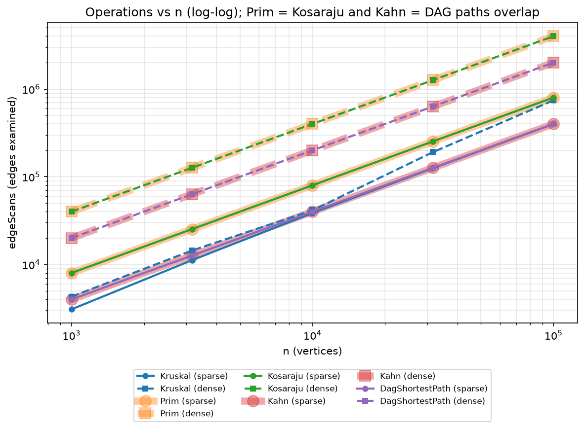
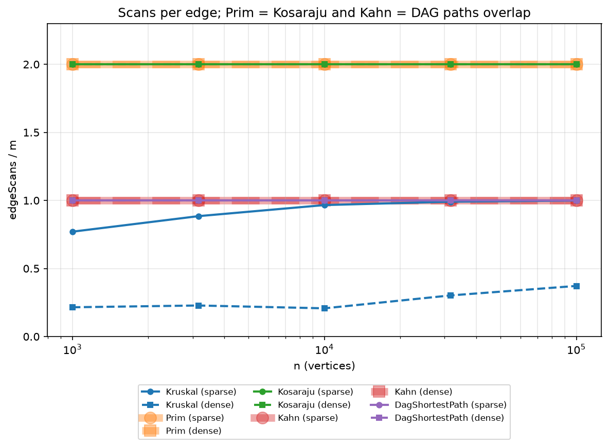
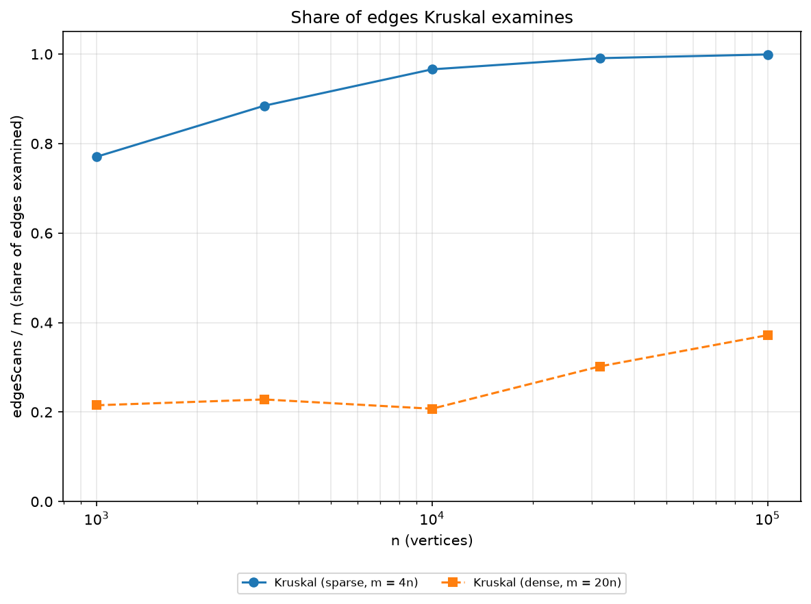

# Assignment 3 Report: Graphs (DSU, MST, SCC, Shortest Paths in DAGs)

Author: Tomiris Alieva
Course: Design and Analysis of Algorithms, AITU

## 1. What was built and how it was measured

One `Graph` class (adjacency list, directed or undirected, `int` weights) feeds all six algorithms: DSU, Kruskal, Prim, Kosaraju, Kahn and the shortest paths in a DAG. Every algorithm is written by hand; only `ArrayList`, `PriorityQueue` and `sort` come from `java.util`.

The benchmark builds ten graphs with the exact generator from the task (`new Random(42)`): n = 1 000, 3 162, 10 000, 31 623, 100 000, each sparse (m = 4n) and dense (m = 20n). It runs five algorithms on them (50 rows in `results/results.csv`) and fails with `CHECK FAILED` if anything is wrong. All reference values from the task are reproduced exactly: MST weights, SCC counts and sums of DAG distances for all ten graphs. Kruskal and Prim agree on every graph, every topological order is validated with `pos[u] < pos[v]`, Kosaraju scans exactly 2m edges, and Kahn and the DAG relaxation scan exactly m.

Counters are incremented inside the algorithms:

- `edgeScans`: edges looked at (adjacency entries for traversals and Prim, sorted-list entries for Kruskal);
- `dsuOps`: `find` calls plus successful `union` calls;
- `comparisons`: weight comparisons inside the sort (Kruskal), the priority queue (Prim) and the relaxation test (DAG paths);
- `maxDepth`: the deepest the explicit DFS stack ever got (Kosaraju).

## 2. Complexity table

V is the number of vertices, E the number of edges, α the inverse Ackermann function.

| Algorithm | Time | Extra space | Justification |
|---|---|---|---|
| DSU `find` / `union` | O(α(V)) amortized | O(V) | Union by rank keeps trees shallow, path compression flattens them; together the amortized cost per operation is α(V), at most 4 for any realistic V. Arrays `parent` and `rank`. |
| Kruskal | O(E log E) | O(E + V) | Sorting E edges costs E log E, then at most E iterations with two `find` calls each, E·α(V) in total. The sorted copy of the edge list and the DSU need O(E + V). |
| Prim (binary heap, lazy) | O(E log E) = O(E log V) | O(E + V) | Every adjacency entry is looked at once (2E) and each non-tree one is pushed into the heap at O(log E). The heap may hold up to O(E) stale entries; plus `inTree[]`. |
| Kosaraju | O(V + E) | O(V + E) | Two DFS passes, each visits every vertex and every edge once. The reversed graph is a full copy, so O(V + E); plus O(V) for the explicit stack, `next[]`, order and components. |
| Kahn | O(V + E) | O(V) | In-degrees in O(E), every vertex enters the queue once, every edge is scanned once when its tail leaves the queue. Arrays `indeg` and `queue`. |
| DAG shortest paths | O(V + E) | O(V) | Kahn for the order, then a single pass relaxing each edge once. Arrays `dist`, `parent`, order. |

## 3. Counters versus formulas

If an algorithm really belongs to its complexity class, the measured counter divided by the formula has to stay constant when n grows. Ratios from `results/analysis.md`:

| Algorithm | Ratio | Density | n=1000 | n=3162 | n=10000 | n=31623 | n=100000 |
|---|---|---|---|---|---|---|---|
| Kosaraju | edgeScans / (V + E) | sparse | 1.600 | 1.600 | 1.600 | 1.600 | 1.600 |
| Kosaraju | edgeScans / (V + E) | dense | 1.905 | 1.905 | 1.905 | 1.905 | 1.905 |
| Kahn | edgeScans / (V + E) | sparse | 0.800 | 0.800 | 0.800 | 0.800 | 0.800 |
| Kahn | edgeScans / (V + E) | dense | 0.952 | 0.952 | 0.952 | 0.952 | 0.952 |
| DAG paths | edgeScans / (V + E) | sparse | 0.800 | 0.800 | 0.800 | 0.800 | 0.800 |
| DAG paths | edgeScans / (V + E) | dense | 0.952 | 0.952 | 0.952 | 0.952 | 0.952 |
| Prim | edgeScans / (2E) | both | 1.000 | 1.000 | 1.000 | 1.000 | 1.000 |
| Prim | comparisons / (E log2 V) | sparse | 2.196 | 2.186 | 2.180 | 2.178 | 2.167 |
| Prim | comparisons / (E log2 V) | dense | 2.616 | 2.533 | 2.473 | 2.421 | 2.381 |
| Kruskal | dsuOps / edgeScans | sparse | 2.972 | 2.848 | 2.776 | 2.757 | 2.751 |
| Kruskal | dsuOps / edgeScans | dense | 2.697 | 2.657 | 2.723 | 2.497 | 2.403 |
| Kruskal | dsuOps / E | sparse | 2.290 | 2.519 | 2.682 | 2.732 | 2.748 |
| Kruskal | dsuOps / E | dense | 0.580 | 0.606 | 0.565 | 0.754 | 0.894 |
| Kruskal | comparisons / (E log2 E) | sparse | 0.891 | 0.907 | 0.869 | 0.809 | 0.745 |
| Kruskal | comparisons / (E log2 E) | dense | 0.903 | 0.846 | 0.784 | 0.720 | 0.666 |

Reading the table:

- **Kosaraju, Kahn, DAG paths.** The ratios are exactly constant for a fixed density, and the constants are the ones the algorithms predict: Kosaraju scans 2m edges, so 2m / (n + m) = 8/5 = 1.600 for m = 4n and 40/21 = 1.905 for m = 20n; Kahn and the DAG relaxation scan m edges, so m / (n + m) = 0.800 and 0.952. This is the linear O(V + E) class.
- **Prim.** It scans every adjacency entry once, so edgeScans / (2E) is exactly 1. The priority-queue work, comparisons / (E log2 V), stays between 2.17 and 2.62 over a hundredfold range of n and drifts down by less than 10 %, which fits O(E log V).
- **Kruskal, sorting.** comparisons / (E log2 E) stays between 0.67 and 0.91. It slowly decreases; the most likely reason is that the weights take only 1 000 different values, so large inputs contain long runs of equal keys that the sort merges cheaply. The ratio is bounded, which matches O(E log E).
- **Kruskal, DSU.** The ratio dsuOps / E from the task is not constant on dense graphs (0.58 to 0.89), because Kruskal stops as soon as all vertices are connected and the share of examined edges changes with n (Section 5, plot 3). Counted per examined edge it is flat (about 2.4 to 3.0). In fact there is an exact identity: dsuOps = 2·edgeScans + 3·(V − 1), since every examined edge costs two `find` calls and every accepted edge adds one `union` with two more `find` calls. For n = 1 000, m = 4 000 this gives 2·3 082 + 3·999 = 9 161, which is the measured value. So the DSU work is linear in the number of examined edges, with α(V) being constant in practice.

## 4. Slope check

On log-log axes a straight line of slope 1 means linear work. Least-squares fit of log10(edgeScans) against log10(n) over the five sizes:

| Algorithm | sparse (m = 4n) | dense (m = 20n) |
|---|---|---|
| Prim | 1.000 | 1.000 |
| Kosaraju | 1.000 | 1.000 |
| Kahn | 1.000 | 1.000 |
| DAG shortest paths | 1.000 | 1.000 |
| Kruskal | 1.055 | 1.119 |

The traversals give 1.00 as expected. Kruskal is slightly steeper, 1.055 on sparse and 1.119 on dense graphs: the number of edges it has to examine before everything is connected grows faster than m (the share in plot 3 rises with n), and on top of that its sort carries the log factor of E log E, which shows up in the `comparisons` column.

## 5. Plots



**Plot 1, operations (edgeScans) vs n, log-log.** All lines are nearly parallel straight lines, that is, linear growth. Prim and Kosaraju have the same values (2m) and so do Kahn and DAG paths (m); the wide pale line under a thin one marks two algorithms on the same points. Dense graphs lie above sparse ones by the factor 5 in m.



**Plot 2, scans per edge (edgeScans / m) vs n.** Flat lines at 2 (Prim, Kosaraju), 1 (Kahn, DAG paths) are the visual confirmation of linear work. Kruskal is below them because it stops early.



**Plot 3, share of edges Kruskal examines.** On sparse graphs Kruskal examines 77 % of the edges at n = 1 000 and 99.9 % at n = 100 000: almost every edge is needed to connect the graph. On dense graphs it examines only 21 % to 37 %, because the graph becomes connected long before the heavy edges are reached. This is where the two MST algorithms differ: Prim always reads all 2m adjacency entries, Kruskal on a dense graph reads about a quarter of them (although it still sorts the whole list; the sort costs roughly 28 million comparisons against roughly 79 million for Prim's heap at n = 100 000, m = 2 000 000).

The iterative DFS depth for Kosaraju reached 59 668 (sparse) and 91 920 (dense) at n = 100 000, and exactly 100 000 on the test path graph. A recursive DFS would need that many stack frames, which is why an explicit stack is required.

## 6. Correctness arguments

### Cut property (Kruskal and Prim)

Let G be a connected weighted undirected graph, (S, V∖S) any cut, and e a lightest edge crossing it; the cut property says that e belongs to some minimum spanning tree. Take any MST T; if e is in T we are done. Otherwise T + e contains exactly one cycle, and this cycle crosses the cut an even number of times, so besides e it contains another crossing edge f. Since e is lightest across the cut, w(e) ≤ w(f), so T' = T − f + e is again a spanning tree of weight at most w(T), hence also minimum, and it contains e. The same exchange works when a set A of edges already known to be in some MST is fixed and no edge of A crosses the cut, so A + e is still contained in an MST. Kruskal uses this when it accepts an edge (u, v) with find(u) ≠ find(v): take S as the component of u in the current forest; no forest edge crosses this cut, and every lighter crossing edge would have been examined earlier and would have merged the two components, so (u, v) is a lightest crossing edge. Prim takes S as the set of vertices already in the tree; the priority queue returns the lightest edge leaving S (stale edges to vertices already in S are skipped), and tree edges do not cross this cut, so that edge is safe as well. Both algorithms repeat the safe step V − 1 times and end with a minimum spanning tree; ties may give different trees, but all MSTs have the same total weight, which the benchmark checks automatically on every graph.

### Induction on the topological order (shortest paths in a DAG)

Let v1, …, vn be the topological order, let every vertex with in-degree 0 start at distance 0, and let δ(v) be the true shortest distance to v from this set of sources. We claim that when the algorithm reaches vi, dist[vi] = δ(vi) and it never changes afterwards. Base case: v1 has no incoming edge, because the tail of such an edge would have to stand before v1 in the order, so v1 is a source and dist[v1] = 0 = δ(v1). Step: assume the claim for v1, …, v(i−1). If vi is a source, nothing ever relaxes it and dist[vi] = 0 = δ(vi); otherwise a shortest path to vi ends with an edge (u, vi), and u = vj with j < i because the order is topological. By the hypothesis dist[u] = δ(u) when u was processed, and relaxing (u, vi) at that moment gave dist[vi] ≤ δ(u) + w = δ(vi). The value dist[vi] is always the length of some real path, so it cannot be smaller than δ(vi); hence dist[vi] = δ(vi), and since every edge into vi has its tail earlier in the order, no later relaxation can touch it. So one pass that relaxes every edge exactly once is enough, which gives O(V + E).

### Why negative weights are safe in a DAG but not in a general graph

Dijkstra's argument, "the closest unfinished vertex cannot be improved any more", needs non-negative weights, because a later edge could otherwise make a path shorter. The DAG algorithm never picks vertices by distance; it picks them in topological order, and the final value of dist[v] follows only from the fact that all edges into v were relaxed before v is processed, which does not depend on the sign of the weights. A DAG has no cycles, so it cannot have a negative cycle either. In a graph with a cycle there is no topological order to follow, and a negative cycle makes the shortest path undefined (every lap makes the path shorter); such graphs need Bellman-Ford, which also detects negative cycles. Our implementation rejects a cyclic input with an exception instead of returning wrong distances.

## 7. Which algorithm when

| Situation | Choice | Why |
|---|---|---|
| MST, edges given as a list, sparse graph (E ≈ 4V) | Kruskal | Sorts the list once and needs no adjacency structure. It examines 77 % to 100 % of the edges here, so the gain over Prim is only the smaller constant (less heap work), not the algorithm class. |
| MST, dense graph (E ≈ 20V), edge list available | Kruskal | Stops after the graph becomes connected: only 21 % to 37 % of the edges are examined, while Prim reads all 2E adjacency entries. |
| MST, dense graph stored as adjacency matrix or very dense (E close to V²) | Prim | Prim needs only adjacency access and grows one tree from a start vertex; with an array instead of a heap it runs in O(V²), and with a Fibonacci heap in O(E + V log V) (neither variant is implemented in this project, this is the standard theory). |
| MST of a graph that may be disconnected | Either | Both return a minimum spanning forest and the number of components: Kruskal by finishing with more than one DSU set, Prim by restarting from every unvisited vertex. |
| Directed graph: which jobs depend on each other in a cycle (deadlock) | Kosaraju (SCC) | A strongly connected component with more than one vertex is a group of jobs that wait for each other. O(V + E), iterative so it survives 100 000 vertices. |
| Order jobs so that dependencies run first, cycle possible | Kahn | Gives the order, and if fewer than V vertices leave the queue, it reports a cycle instead of a wrong order. If it reports a cycle, run Kosaraju to find the jobs involved. |
| Fastest route through a pipeline, no cycles, weights may be negative | DAG shortest paths | One pass in topological order, O(V + E), safe with negative weights. |
| Shortest paths in a graph with cycles | Dijkstra for non-negative weights, Bellman-Ford for negative ones | The DAG pass is not applicable without a topological order (not implemented here). |
| Input is an edge list vs adjacency list | Edge list: Kruskal. Adjacency list: Prim, Kosaraju, Kahn, DAG paths | Kruskal only needs the edges sorted by weight; the other algorithms need fast access to the neighbours of a vertex. |
| Need to know whether a cycle exists | Kahn first | O(V + E), and the answer comes for free with the order. |

## 8. Wall-clock time

Times in `results/results.csv` are medians of five runs measured on a Windows machine with JDK 25 and IntelliJ running in the background. At n = 100 000 they were, for sparse and dense graphs: Kruskal 102 ms and 494 ms, Prim 295 ms and 2 135 ms, Kosaraju 173 ms and 871 ms, Kahn 25 ms and 134 ms, DAG paths 67 ms and 254 ms. These numbers agree with the counters in direction, but they are not the evidence: other hardware, another JVM version, JIT warm-up and background load change them. On the two smallest graphs the clock is mostly noise: for example, Kahn on the sparse graph took 1.5 ms at n = 1 000 but 0.5 ms at n = 3 162, and Kosaraju on the dense graph took 14.0 ms and then 9.9 ms, although the work grows. The operation counters, in contrast, are identical on every machine, so all conclusions above are drawn from them.

## 9. Reproducing the results

```
mvn test
mvn -q compile exec:java
python scripts/plots.py
```

`mvn test` runs the JUnit 5 tests (DSU against a reference, Kruskal against Prim on 100 random graphs, Kosaraju against brute force, Kahn on a DAG and on a cyclic graph, DAG paths against Bellman-Ford with negative weights, and a 100 000-vertex path for stack safety). The benchmark prints the reference check and writes `results/results.csv`; the script builds the three plots and `results/analysis.md`.